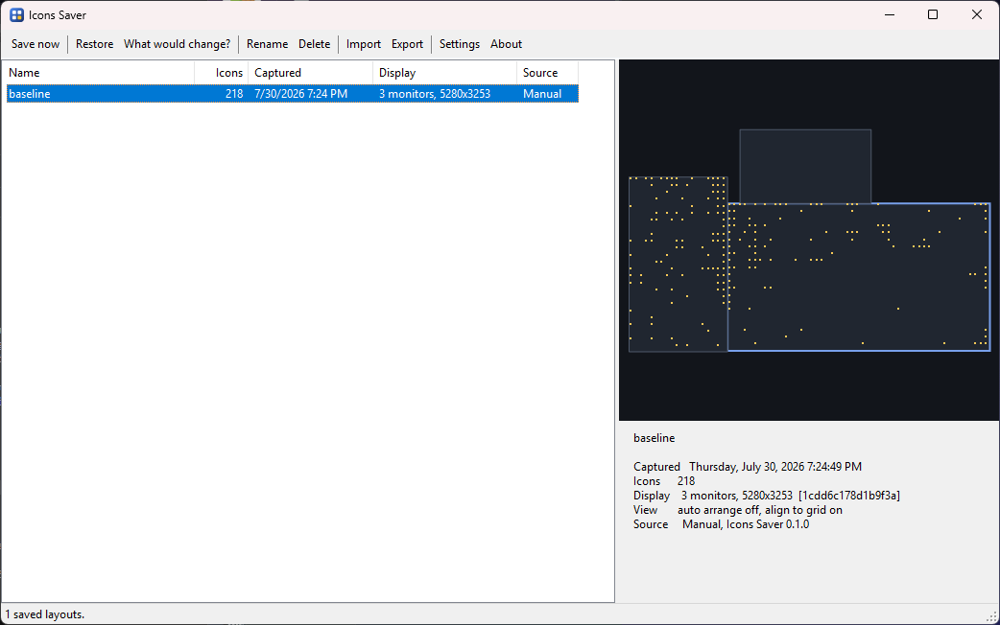

# Icons Saver

Save and restore the positions of your Windows desktop icons.

Windows loves rearranging desktop icons. You unplug a monitor, a game changes the
resolution, a driver updates, the shell restarts — and every icon is suddenly piled
into the top-left corner. **Icons Saver** takes a snapshot of exactly where every icon
sits and puts them all back with one click.



## Features

- **Exact restore.** Positions are read from and written to the shell's own icon view,
  so an icon lands on the pixel it came from, not near it.
- **Named layouts.** Keep as many as you like: one for the docked setup, one for the
  laptop on its own, one from before you tidied up.
- **Automatic snapshots.** A rolling history is taken in the background, so there is
  something to go back to even when you forgot to press Save.
- **Lock the ones you care about.** A locked layout is never pruned by the automatic
  history and refuses to be deleted, so the good one cannot quietly disappear.
- **Automatic restore.** When the display arrangement changes, the matching layout is
  put back once the shell has settled.
- **Display-aware.** Every layout records the monitor arrangement it belongs to, and a
  layout is never applied to a setup where its coordinates would make no sense.
- **Preview before you commit.** "What would change?" reports exactly which icons would
  move, which are gone, and which are new — without touching anything.
- **Global hotkeys.** <kbd>Ctrl</kbd>+<kbd>Alt</kbd>+<kbd>S</kbd> to save,
  <kbd>Ctrl</kbd>+<kbd>Alt</kbd>+<kbd>R</kbd> to restore, from anywhere.
- **Dark by default.** Light and "follow Windows" are a click away in settings.
- **A real CLI.** Everything the window does, scriptable.
- **Plain JSON on disk.** Readable, diffable, portable, non-ASCII names intact.
- **No installer, no service, no admin rights.** A single executable that talks to your
  own explorer process.

## Requirements

- Windows 10 or Windows 11, 64-bit
- [.NET 8 Desktop Runtime](https://dotnet.microsoft.com/download/dotnet/8.0)

## Getting started

```powershell
git clone https://github.com/KilluaZoldyck0099/Icons-Saver.git
cd "Icons Saver"
dotnet build IconsSaver.sln -c Release
```

The tray application ends up at
`src/IconsSaver.App/bin/Release/net8.0-windows/IconsSaver.exe` and the command line tool
at `src/IconsSaver.Cli/bin/Release/net8.0-windows/iconssaver-cli.exe`.

Run the app, press **Save now**, and you have a layout to come back to.

### Building something you can hand to someone else

Those are build outputs and need the files around them. To get two standalone executables
that run on any 64-bit Windows 10 or 11 with nothing installed at all:

```powershell
dotnet publish src/IconsSaver.App/IconsSaver.App.csproj -c Release -r win-x64 --self-contained true -p:PublishSingleFile=true -p:EnableCompressionInSingleFile=true -p:IncludeNativeLibrariesForSelfExtract=true -p:DebugType=none -o publish
dotnet publish src/IconsSaver.Cli/IconsSaver.Cli.csproj -c Release -r win-x64 --self-contained true -p:PublishSingleFile=true -p:EnableCompressionInSingleFile=true -p:IncludeNativeLibrariesForSelfExtract=true -p:DebugType=none -o publish
```

That leaves `publish\IconsSaver.exe` (about 69 MB) and `publish\iconssaver-cli.exe` (about
34 MB), each a single file with nothing beside it. They are large because the .NET runtime
is inside them, which is the whole point: there is nothing for the other person to install.

Two things to warn whoever you send it to:

- **SmartScreen.** The executables are unsigned, so the first run shows "Windows protected
  your PC". They have to click **More info → Run anyway**. Code signing is the only real
  fix and it costs money.
- **Antivirus.** Icons Saver writes into explorer's memory to move the icons — that is the
  only way to do this at all — and some products flag that pattern generically. See
  [SECURITY.md](SECURITY.md) for exactly what it does and where that code lives.

## Command line

```
iconssaver-cli <command> [options]

  save [name]            Capture the current icon layout
  list                   List saved layouts
  restore [id|latest]    Put a saved layout back
  show <id>              Print every icon in a layout
  delete <id>            Delete a layout
  export <id> <file>     Write a layout to a file
  import <file>          Read a layout from a file
  status                 Show the desktop and display state
  version                Print the version

  --name, -n <text>      Name to save the layout under
  --force, -f            Restore even onto a different display setup
  --dry-run              Report what a restore would do, without moving anything
```

Layout ids can be abbreviated to any unambiguous prefix, so `iconssaver-cli restore 63e2`
works.

Taking a snapshot before something risky is a one-liner worth putting in a script:

```powershell
iconssaver-cli save "before the driver update"
```

## Where things are kept

Everything lives under `%APPDATA%\IconsSaver`:

| Path | Contents |
| --- | --- |
| `layouts\` | Layouts you saved yourself |
| `auto\` | The rolling automatic history |
| `settings.json` | Your settings |
| `logs\iconssaver.log` | A small diagnostic log |

A layout is a single JSON document. Nothing stops you editing one by hand.

## How it works

Desktop icons live in a `SysListView32` owned by `explorer.exe`, and Icons Saver reads
and writes their positions by talking to it directly. There are a few sharp edges in
doing that well — cross-process memory, the 16-bit coordinate trap, auto arrange, DPI —
and they are written up in [docs/how-it-works.md](docs/how-it-works.md).

## Known limitations

- **Auto arrange is turned off by a restore, and left off.** With it on, Windows repacks
  the icons into a grid the instant it is re-enabled, which would undo the restore. The
  app tells you when it has done this.
- **Icons are matched by display name.** Rename a file and its saved position no longer
  finds it. Everything else in the layout still restores.
- **Positions applied through the list view may not survive an explorer restart.** Since
  Windows 10 1809 the shell keeps its own record of icon placement, and it does not
  learn about changes made this way. Restoring again puts them back.
- **"Show desktop icons" must be on** to capture a layout. There is nothing to read
  otherwise, and the app says so rather than saving an empty layout.

## Contributing

Bug reports and pull requests are welcome — see [CONTRIBUTING.md](CONTRIBUTING.md).

## License

[MIT](LICENSE)
